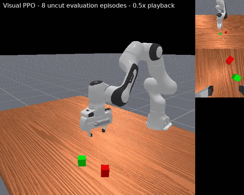

# CubeStack: Visual PPO for Robotic Manipulation in ManiSkill

基于 ManiSkill / SAPIEN / PhysX CUDA 的双视角视觉强化学习项目。项目以 Franka Panda 的 `StackCube-v1` 为实验基准，围绕视觉部分可观测性、Actor/Critic 信息边界、状态归一化、动作连续性以及训练—评估目标一致性，对 PPO 进行了完整的单变量消融。

最终方案没有继续堆叠 reward trick，而是定位到一个更根本的问题：原训练在首次成功时立即 reset，但评估要求策略在固定 50 步时域结束时仍保持成功。仅将训练改为 `NoEarlyReset`，就在 3 个独立训练 seed 上同时提高了平均性能并大幅降低方差。

## Demo

[](https://github.com/charlie-tib/CubeStack-based-on-Maniskill/blob/main/assets/cubestack_demo.mp4)

[播放 / 下载完整 MP4](https://github.com/charlie-tib/CubeStack-based-on-Maniskill/raw/refs/heads/main/assets/cubestack_demo.mp4)

2026-10-18 在 RTX 5090 上按最终方案 `B4-Norm + NoEarlyReset` 重训：训练 seed 为 `1`，实际训练 **9,984,000 steps**。视频展示评估 seed `404` 的 **8 个连续完整回合**，不筛选片段，全部终局成功；以 **0.5×** 速度播放，便于观察抓取、堆叠与释放过程。

该次重训另在评估 seeds `101/202/303` 上各运行 100 回合，终局成功率分别为 **81% / 81% / 78%**，合计 **80%**（300 回合）。这是一次独立的单训练 seed 重跑，不替代下方历史三训练 seed 的统计结果；演示的 8/8 也不作为整体成功率。

## 核心结果

每个训练 seed 使用评估 seeds `101/202/303`，每个评估 seed 运行 100 episodes，因此每种方法共计 900 个最终评估 episodes。

| 方法 | Success once | Success at end | Return | End 标准差 |
|---|---:|---:|---:|---:|
| B4-Norm（Early Reset） | 65.7% ± 23.9pp | 40.1% ± 34.6pp | 34.99 ± 2.57 | 34.6pp |
| **B4-Norm + NoEarlyReset** | **85.1% ± 4.8pp** | **77.1% ± 5.7pp** | **36.82 ± 1.18** | **5.7pp** |
| 改进 | **+19.4pp** | **+37.0pp** | **+1.83** | **-28.9pp** |

配对结果如下：

| 训练 seed | B4-Norm once / end | NoEarlyReset once / end |
|---:|---:|---:|
| 1 | 84.0% / 68.0% | 88.7% / 82.3% |
| 2 | 38.7% / 1.3% | 87.0% / 78.0% |
| 3 | 74.3% / 51.0% | 79.7% / 71.0% |

这里的 `success_once` 表示 episode 中至少成功过一次；`success_at_end` 表示第 50 步结束时仍满足“红方块正确堆叠、保持静止且夹爪已释放”。后者是更严格、更贴近稳定操作的指标。

## 项目做了什么

### GPU 并行视觉 PPO

- 使用 `physx_cuda` 同时运行 512 个向量化环境。
- 在 GPU 上批量执行物理步进、场景 reset、双相机 RGB 渲染和 PPO rollout。
- 每组训练 10M environment steps；rollout 为 `512 env × 50 steps`。
- 使用固定第三人称 `base_camera` 和腕部 `hand_camera`，单帧拼接后为 6 通道 RGB。
- 训练、评估、checkpoint、TensorBoard 和多 seed 队列均自动化。

### 从 B0 到 B4 的方法演进

```text
base RGB ──> camera-specific CNN ──┐
hand RGB ──> camera-specific CNN ──┼─> visual feature ─┐
四帧历史，每帧两路相机             │                  ├─> Actor ─> action
normalized 25-D proprio ──────────┘                  │
                                                     └─> auxiliary 23-D state prediction

normalized full 48-D simulator state ──> privileged Critic ─> V(s)
```

| 组别 | Actor 输入 | Critic 输入 | 相对上一组的唯一结构变化 |
|---|---|---|---|
| P0 | 双相机 RGB | 双相机 RGB | 不输入低维状态 |
| B0 | RGB + 25-D proprio | RGB + 25-D proprio | 加入真实机器人可获取的本体状态 |
| B1 | RGB + proprio | 完整 48-D state | 不对称 Actor-Critic |
| B2 | 两路 RGB 独立编码 + proprio | 完整 state | 基座/腕部相机使用独立 CNN |
| B3 | 连续四帧双相机 RGB + proprio | 当前完整 state | 用帧堆叠补充运动趋势 |
| B4 | 与 B3 相同 | 当前完整 state | 视觉特征增加 23-D 特权状态预测头 |
| B4-Norm | 与 B4 相同 | 与 B4 相同 | RGB `/255`，state 使用 running mean/std 并裁剪到 `[-5,5]` |

Actor 始终只能读取前 25 维机器人状态：`qpos(9) + qvel(9) + tcp_pose(7)`。后 23 维包含两个方块位姿和相对位置，只能用于训练期 Critic 和 B4 辅助监督，不能进入部署 Actor。

### 第一性原理

| 问题 | 改动 | 原理 |
|---|---|---|
| 单帧 RGB 不含显式速度 | 四帧堆叠 | 从帧间变化恢复末端和方块的运动趋势，缓解部分可观测性 |
| 固定相机与腕部相机的数据分布不同 | 独立视觉编码器 | 避免同一组卷积核同时适配全局固定视角和随机器人移动的局部视角 |
| Actor 部署时不能使用仿真真值，纯视觉 Critic 又容易产生高方差 advantage | 不对称 Actor-Critic | Actor 保持可部署，Critic 利用训练期特权状态降低价值估计和策略梯度方差 |
| PPO reward 对视觉表征的监督间接 | 23-D 辅助预测头 | 使用物体几何状态提供稠密表示监督，但预测值不回灌 Actor，避免真值泄漏 |
| proprio、位姿和图像特征尺度不一致 | 逐维 running normalization | 改善多模态网络的优化条件，不增加任何任务信息 |
| 相邻动作抖动影响接近、抓取和搬运 | Temporal CAPS | 对同一 episode 内相邻状态的确定性动作均值施加连续性正则 |
| 训练只学会“碰到成功”，评估却要求“保持到结束” | NoEarlyReset | 让成功后的释放、撤离、保持和纠错进入真实优化轨迹，直接对齐训练目标与评估指标 |

## Reward 设计

本项目没有在 ManiSkill reward 上继续叠加大量手工小项，而是保留 `StackCube-v1` 的分阶段 normalized dense reward：

1. 接近红方块：根据 TCP 到 cube A 的距离给出约 `0–2`。
2. 抓取后搬运：基础奖励为 4，并根据 cube A 到 cube B 上方目标点的距离增加至约 5。
3. 堆叠后释放与静止：基础奖励为 6，根据夹爪释放程度和方块静止程度增加至约 7。
4. 完整成功：位置正确、方块静止且已释放时奖励为 8。
5. 训练使用 `normalized_dense`，最终除以 8。

奖励按当前任务阶段覆盖，而不是把大量微小项同时相加。这减少了权重冲突和 reward loophole。NoEarlyReset **不修改奖励公式**；它改变的是奖励在时间维度上的作用范围：稳定保持可继续获得高奖励，碰倒后奖励下降，因此策略自然学习成功后的安全行为。

## 完整实验结论

以下是最有代表性的单训练 seed 结果；每行均使用 3 个评估 seed、共 300 episodes。完整实验史、诊断和负结果见 [docs/EXPERIMENT_LOG.md](docs/EXPERIMENT_LOG.md)，结构化数据见 [results/summary.csv](results/summary.csv)。

| 实验 | Once | End | Return | 结论 |
|---|---:|---:|---:|---|
| P0 RGB-only | 44.7% | 30.0% | 32.50 | 纯视觉可以学习，但缺少机器人状态 |
| B0 raw proprio | 21.3% | 4.0% | 31.85 | 未归一化 proprio 破坏多模态优化 |
| B0-Norm | 73.0% | 63.3% | 35.25 | 单一 normalization 带来巨大收益 |
| B1 privileged Critic | 79.0% | 46.7% | 35.31 | 特权 Critic 提高到达成功状态的能力 |
| B3-Norm | 62.0% | 41.0% | 32.87 | normalization 主要改善稳定保持 |
| B4-Norm | 84.0% | 68.0% | 37.57 | seed 1 强，但后来发现训练 seed 方差很大 |
| AnnealLR | 83.7% | 65.0% | 37.30 | 与 B4-Norm 基本持平 |
| Beta-PPO | 53.3% | 1.3% | 31.87 | 有界策略并未自动带来稳定控制 |
| TCAPS | 89.3% | 67.0% | 38.35 | 提高首次成功率，但 early reset 下无法学习成功保持 |
| NoEarlyReset | 88.7% | 82.3% | 38.01 | seed 1 最佳终局表现 |
| NoEarlyReset + TCAPS | 87.3% | 77.3% | 37.49 | 两种机制存在负交互 |
| Pre-success TCAPS | 86.0% | 79.3% | 37.55 | gating 有所恢复，仍未超过纯 NoEarlyReset |
| Actor-DrAC Photo | 0.0% | 0.0% | 0.49 | 视觉一致性正则在当前系数下训练失败 |
| B0-Norm + gSDE | 0.0% | 0.0% | 24.62 | latent 尺度使有效动作 std 爆炸 |
| B4-Norm, gamma=0.95 | 10.0% | 4.0% | 33.51 | 长信用分配显著恶化 |

### 为什么 TCAPS + NoEarlyReset 没有得到“1+1>2”

TCAPS 对整个策略参数施加平滑偏置。它有利于接近、抓取和搬运，却可能限制堆叠后的快速释放、撤离与纠错；NoEarlyReset 恰好需要策略学习这些成功后的非平稳动作。因此全程 TCAPS 将 seed 1 的 end 从 NoEarlyReset 的 82.3% 降至 77.3%。仅在首次成功前启用 TCAPS 后，end 恢复到 79.3%，说明负交互确实主要来自成功后阶段，但共享参数仍使两个行为阶段无法完全解耦。

### 失败实验带来的信息

- **Beta-PPO**：动作天然有界并不意味着优化更容易；它同时改变了探索分布、策略梯度几何和输出头初始化。
- **DrAC**：强行保持光度增强前后的策略一致性，在单任务固定视觉域中可能压制控制所需的细粒度视觉差异。
- **gSDE**：论文方法不能不检查尺度就接到 512-D ReLU latent；实际有效 action std 从约 0.58 增长到 5.62，连续性代价和熵同步爆炸。
- **gamma=0.95**：更长的信用分配范围并未提高保持能力，反而削弱了 StackCube 明确的阶段奖励信号。
- **单训练 seed**：B4-Norm seed 1 的 84%/68% 很乐观，但 seed 2 只有 38.7%/1.3%；评估更多 episode 不能替代独立训练 seed。

## 安装

本代码是 ManiSkill 的实验层，不复制整个上游模拟器。实验基于 ManiSkill commit `42b68244c1497cef889b04c4f4a78aa01c927f4e`。

```bash
git clone https://github.com/haosulab/ManiSkill.git
cd ManiSkill
git checkout 42b68244c1497cef889b04c4f4a78aa01c927f4e
pip install -e .

cd ..
git clone https://github.com/charlie-tib/CubeStack-based-on-Maniskill.git
cd CubeStack-based-on-Maniskill
pip install -r requirements.txt
```

需要支持 CUDA 的 NVIDIA GPU。完整配置使用 512 个并行环境；显存不足时可先将 `--num-envs` 降至 32 做 smoke test。

## 复现最终方案

### 训练与评测配置

以下为 2026-10-18 RTX 5090 单训练 seed 重跑（主页 Demo 对应模型）的实际配置：

| 参数 | 设置 |
|---|---|
| 算法与方案 | PPO · `b4_norm` + `NoEarlyReset` |
| 学习率 | `3e-4` |
| 并行训练环境数 | `512` |
| 每轮采样步数 | 每环境 `50` 步，共 `25,600` 步 |
| Mini-batch 大小 / 数量 | `800` / `32` |
| 每轮 PPO 更新 epochs | `4` |
| 折扣因子 γ / GAE λ | `0.8` / `0.9` |
| PPO clip / Target KL | `0.2` / `0.2` |
| 训练预算 | 请求 `10,000,000` 步；实际 `390 × 25,600 = 9,984,000` 步 |
| 训练 seed | `1` |
| 视觉输入 | 基座与腕部双相机，各 `128 × 128` RGB；堆叠连续 `4` 帧 |
| 数值精度 | FP32 |
| 输入归一化 | RGB 除以 `255`；低维状态逐维 running mean/std，裁剪到 `[-5, 5]`；评测冻结统计量 |
| 成功后的重置 | `--no-partial-reset`：不在首次成功时提前重置，保持固定 `50` 步时域 |
| 正式评测 | seeds `101/202/303`，各 `100` 回合，共 `300` 回合；`16` 个并行评测环境 |
| Demo 录制 | seed `404`，`1` 个环境，连续 `8` 个完整回合；展示为 `0.5×` 播放 |
| 训练期间录制 | 关闭视频录制；训练完成后单独录制 Demo |

模拟器固定为 ManiSkill commit `42b68244c1497cef889b04c4f4a78aa01c927f4e`；本次训练使用的项目代码 commit 为 `dc754a23a29ed0bae9d41201919ff1beb6f37e69`。该次重跑的 300 回合评测与上方历史三训练 seed、900 回合统计分开报告。

### 运行命令

单个训练 seed：

```bash
PYTHONPATH=. python src/ppo_stackcube.py \
  --experiment b4_norm \
  --exp-name StackCube-v1__B4-Norm-NoEarlyReset__seed1 \
  --seed 1 \
  --total-timesteps 10000000 \
  --num-envs 512 \
  --num-steps 50 \
  --num-minibatches 32 \
  --update-epochs 4 \
  --learning-rate 3e-4 \
  --gamma 0.8 \
  --gae-lambda 0.9 \
  --clip-coef 0.2 \
  --target-kl 0.2 \
  --no-partial-reset
```

完整 3 个训练 seed 和 3×100 固定评估：

```bash
PYTHON_BIN=python ./scripts/run_final_multiseed.sh
```

四个 PPO 优化分支的 smoke 或完整实验：

```bash
PYTHON_BIN=python ./scripts/run_b4_optimization_ablation.sh smoke
PYTHON_BIN=python ./scripts/run_b4_optimization_ablation.sh full
```

## 测试

```bash
PYTHONPATH=. python -m unittest discover -s tests -v
```

测试覆盖：

- P0/B0 特权信息隔离；
- B1–B4 单变量架构契约；
- feature-wise normalization、裁剪和 checkpoint roundtrip；
- Beta 动作边界、log-prob、entropy 和确定性均值；
- TCAPS reset mask 与 pre-success 状态机；
- DrAC 只修改 RGB，不影响 proprio、Critic 和辅助目标；
- gSDE 解析方差、重采样计划、PPO 梯度和 checkpoint roundtrip。

## 仓库结构

```text
src/ppo_stackcube.py              # P0/B0/B1–B4、Norm、Beta、TCAPS、DrAC、NoEarlyReset
src/ppo_gsde.py                   # B0-Norm + gSDE 负结果复现
scripts/                          # smoke、完整训练和多 seed runner
tests/                            # 信息边界、数值和回归测试
results/summary.csv               # 已完成实验的结构化结果
docs/EXPERIMENT_LOG.md            # 全部实验过程、失败分析与结论
```

模型 checkpoint、TensorBoard event 和原始录制默认写入 `runs/`，不提交到 Git；主页演示用的 MP4 与 GIF 单独保存在 `assets/`。

## 局限性

- 主结论目前基于单个 StackCube 任务和 3 个训练 seeds；若作为论文级结论，应扩展到至少 5–10 seeds 和更多接触操作任务。
- Actor 仍使用仿真的 RGB 与 proprio，尚未完成相机扰动、动力学随机化或真实机械臂 sim-to-real。
- NoEarlyReset 的收益同时包含目标对齐和更长的成功后数据分布，后续可进一步分析成功保持时长、首次成功时刻和失败类型。

## 致谢与许可

训练代码源自 ManiSkill 的 PPO baseline，并基于 CleanRL 风格实现扩展。ManiSkill 与本仓库代码按 Apache-2.0 许可证发布。相关方法包括 PPO、GAE、gSDE、CAPS、DrAC 和 Beta policy；论文链接整理在 [docs/EXPERIMENT_LOG.md](docs/EXPERIMENT_LOG.md)。
